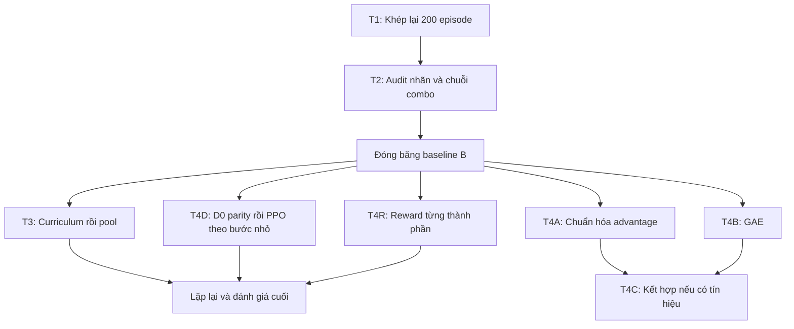

# Plan và tracker cải tiến Bomberman

Cập nhật: MOVE/A1/B1/R1 đã review/gate FAIL; B0/D0 PASS tính đúng. D1 DONE/REVIEWED, gate FAIL; giữ checkpoint B. D2/D3 và các nhánh reward khác giữ điều kiện mở riêng; chưa triển khai tự động từ test D1.

## 1. Mục tiêu và điểm xuất phát

Mục tiêu chính là CNN tự đặt bom để hạ đối thủ và vẫn sống, qua safety mask hiện tại. Chỉ số chính: **ActiveWR**; chỉ số đi kèm: tự nổ, hòa, kills, thắng thụ động và chênh lệch A0/A1. Giảm loss hoặc tăng reward train chỉ là tín hiệu chẩn đoán.

| Nội dung | Hiện trạng có bằng chứng |
|---|---|
| Model đang giữ | `runs/pressure-C-next/final_phaseC.pt`; chưa thay model gốc |
| Teacher | Có `local`, `two_bomb`, `local_combat_move`; mặc định `local`. MOVE pilot đã hoàn tất/gateFAIL; T4-A1 dùng local |
| Pilot đầu | Local 200 episode; two_bomb 146 do hết thời gian; không đủ kết luận lượt đầy đủ |
| Lượt đầy đủ mới | `runs/two-bomb-complete-20261014-031626`: log đã có 200 episode và validation 0/100/200 |
| Validation two_bomb mới | Episode 0: ActiveWR 29%; episode 100: 18%; episode 200: 15%, tự nổ 0%, hòa 81%; best vẫn episode 0 |
| Đánh giá cuối lượt mới | Đủ 1.200 trận; gốc/two_bomb best0 ActiveWR36,5%, local38%; two_bomb chưa đạt gate, giữ gốc |
| T2 audit/review | `t2-full-20261014-060320`: 400 trận tổng, B33%/final20016%; delta−17 điểm, CI[-25,5;−8,5]; ưu tiên L2 kiểm tra candidates qua future mask |
| L2.0 candidate audit | `l2-full-20261014-120348`:149 states/40 tapes; candidate khả thi10→85, best hai bom10, genuine trap0; chọn T3.1 benchmark trước train |
| T3.1 benchmark | `t3-full-20261014-implementation`:96/96 combo reference/teacher qua mask; B trên combo static87,5%, evader47,92%, Rule38,54%; chọn curriculum, giữ B |
| Audit sau curriculum | `t3-approach-audit-20261015-final`: teacher giải32/32 approach, CNN yếu đoạn gần mục tiêu;96 counter checks/119 tests PASS; giữ B, chưa sửa mask/train |
| Thuật toán hiện tại | MC/raw mặc định; A1 và B1 gateFAIL; GAE actor opt-in quaB0; criticMC, Adam một update/episode |
| Loss hiện tại | Policy + `0.5 × value` − entropy + `0.5 × escape` + `0.5 × combat` + `0.2 × navigation` |
| Luật trận | Phase C: 9×9, 2 agents, tối đa 500 bước; observation 12 kênh |

Nguồn hiện trạng: [trainer](/D:/fpt/subject/BomberMan/train_actor_critic.py), [môi trường](/D:/fpt/subject/BomberMan/bomberman_env.py), [báo cáo T1 đầy đủ](/D:/fpt/subject/BomberMan/runs/two-bomb-complete-20261014-031626/T1_report.md), [báo cáo pilot đầu](/D:/fpt/subject/BomberMan/runs/two-bomb-pilot-20261014/report.md).

## 2. Tracker tổng và cách cập nhật

Trạng thái dùng trong tài liệu: **READY** = có thể làm; **TODO** = chưa làm; **WAIT** = chờ đầu vào/kết quả; **PASS** = qua tiêu chí; **FAIL** = không qua; **INCONCLUSIVE** = dữ liệu/chạy thử chưa đủ; **DEFERRED** = chỉ mở khi có bằng chứng cần thiết. Hoàn thành việc chạy vẫn có thể dẫn tới quyết định FAIL; không chạy lại chỉ để tìm một kết quả đẹp.

| ID | Task | Trạng thái hiện tại | Phụ thuộc | Đầu ra cần giữ |
|---|---|---|---|---|
| T1 | Khép lại two_bomb đủ 200 episode | Hoàn tất; gate cải tiến FAIL, giữ gốc | Không | Summary, ba đánh giá theo seed, quyết định giữ/chọn candidate |
| T2 | Kiểm tra chất lượng nhãn và việc thực hiện combo | T2/L2.0 hoàn tất; giữ B; L2.1/2 deferred sau benchmark | T1 đã đóng | `T2_decision.md`, `L2_decision.md`, analysis JSON và replay |
| T3 | Curriculum giao tranh và opponent pool | Guidance MOVE full DONE/REVIEWED15/10; gateFAIL,giữB; runtime guard/C2/C3 tách riêng | Candidatepoint40,25% vsB35/control35,5;haiCI chứa0 | `decision_report.md`, `analysis_results.json`; không train/test thêm trongpilot này |
| T4 | Advantage, GAE, PPO và reward | D1 gate FAIL; giữ checkpoint B; B0/D0 PASS | D1 đủ200ep/arm,400test/model; full-state verified | `runs/ppo-full-20261015-220313/decision_report.md`, `PPO_PILOT_GUIDE.md` |
| SD | Sudden death (SD1–SD5, XC) | SD1–SD4 DONE (SD4.1 PASS: WR +10.75; SD4.6 search cả trận +5.75 ActiveWR); XC: nhánh bạn hơn B +7.5 ActiveWR; SD5 (hướng a): merge DONE, SD5.0 ĐẠT (+22.5 ActiveWR với search trên F), SD5.1 gate FAIL (search − F −2.75 ActiveWR), giữ F | Tracker riêng | `PLAN_SUDDEN_DEATH.md` |

Mỗi task con có checkbox; chỉ đánh dấu khi có bằng chứng và ledger. T4-A1 đã chạy/review đầy đủ theo yêu cầu; các nhánh chưa đánh dấu chưa được khởi động. Người chạy train có thể là bạn hoặc Codex khi được yêu cầu.



T3 và T4 là các nhánh có đối chứng riêng. Không cần hoàn tất cả opponent pool mới được thử chuẩn hóa advantage. Kết quả curriculum không tự động được đưa vào một thử nghiệm optimizer đang chạy.

## 3. Quy tắc chung cho mọi thử nghiệm

### 3.1. Baseline, đối chứng và tách biến

- Baseline **B** mặc định: trọng số model gốc, teacher local, luật/mask/reward hiện tại. Ghi SHA256 của checkpoint và source. Chỉ đổi B sau một quyết định có bằng chứng và ghi thành phiên bản mới.
- Mỗi candidate có **đối chứng được train thêm cùng ngân sách**, từ cùng B, cùng train seed. So thêm với B chưa train để biết có hơn điểm xuất phát không.
- Trong từng cặp, giữ nguyên board size, opponents, observation, reward, teacher, LR schedule, entropy schedule, loss weights, validation và inference; chỉ đổi biến đã ghi ở dòng thí nghiệm.
- Thay source liên quan thì chạy lại đối chứng. Không dùng local 200 của T1 làm đối chứng cho GAE/PPO/curriculum mới chỉ vì cùng số episode. T1 dùng lại local vì script kiểm tra source/config/checkpoint còn đúng.
- Checkpoint raw hiện chỉ lưu trọng số. `resume_from` là warm-start với optimizer/scheduler mới, không phải tiếp tục chính xác Adam và RNG của lượt cũ. Hai nhánh phải có cùng cách khởi tạo.
- Giữ riêng best chọn bằng validation và final. Không chọn giữa best/final bằng điểm test. Nếu chấm final thêm, ghi rõ là chẩn đoán thứ cấp.

### 3.2. Các tầng test và ngân sách

| Tầng | Cần làm | Công dụng và giới hạn |
|---|---|---|
| Kiểm tra logic | Test toán/physics/mask và đường chạy nhỏ | Phát hiện implementation sai; chưa chứng minh agent tốt |
| Smoke | 10–20 episode, validation nhỏ chẵn số trận | Kiểm tra NaN, state, tốc độ, bộ nhớ, file đầu ra; không chọn winner |
| Sàng lọc | 200 episode/candidate và đối chứng; validation 100 trận ở 0/100/200 | Chọn tối đa một cấu hình mỗi nhánh bằng validation, không quét lưới lớn |
| Xác nhận pilot | 400 trận/model, 200 board seeds × A0/A1, CPU/mask chung | Ước lượng chênh lệch model cố định; chưa tính hết biến thiên train |
| Lặp lại | Ít nhất 3 train seeds cho nhánh được chọn và đối chứng | Xem độ ổn định; không chạy 3 seeds cho mọi ý tưởng ngay |

200 episode là ngân sách sàng lọc cho thay đổi nhỏ, không bảo đảm hội tụ. Curriculum/pool có thể cần 600/400 episode tương ứng; đối chứng của chúng dùng đúng ngân sách đó. Muốn tăng ngân sách sau khi nhìn kết quả phải tạo experiment mới, giữ kết quả cũ và chạy lại cặp tương ứng. Ghi thêm learner steps, optimizer steps, thời gian và peak memory để biết chi phí thực.

### 3.3. Seed và bộ dữ liệu

| Bộ | Seed đề xuất/cố định | Mục đích |
|---|---|---|
| Train pilot | 2026101303 | Cùng seed trong một cặp, như T1 |
| Train lặp lại | 2026101303, 2026101304, 2026101305 | Sau khi chọn cấu hình bằng validation |
| Validation Phase C | 21000–21049, mỗi seed A0/A1 | 100 trận; giữ guard hiện tại |
| Test T1 | 26000–26199, mỗi seed A0/A1 | Đã cố định trong script mới; sau khi xem thì không dùng để tune |
| Audit T2 | 28000–28099, mỗi seed A0/A1 | Dữ liệu chẩn đoán; không dùng làm test cuối |
| Test xác nhận sau T1 | `30000 + 1000 × confirm_id` đến `+199` | Mỗi đợt một bộ 200 seeds mới, đăng ký trước; `confirm_id` bắt đầu từ 1 |

Kiểm tra registry/config cũ trước khi dùng seed đề xuất, rồi ghi bộ đã dùng vào ledger. Các bộ train/validation/audit/test có vai trò khác nhau; không chỉnh method dựa trên test rồi gọi chính test đó là held-out.

### 3.4. Gate quyết định

**Sàng lọc bằng validation:** candidate đã chạy đủ, đạt guard tự nổ của warm-start, và best validation tốt hơn đối chứng theo thứ tự hiện có. Có tín hiệu tốt thì mới cấp ngân sách xác nhận; chưa đạt thì ghi FAIL hoặc INCONCLUSIVE có lý do. Được mở một nhánh nhỏ tiếp theo khi log chỉ ra nguyên nhân cụ thể, không chạy lại vô hạn.

**Pilot xác nhận model:** ActiveWR tăng ít nhất **5 điểm phần trăm** so với cả B và đối chứng train thêm; tự nổ quan sát không cao hơn cả hai; CI 95% chênh lệch ActiveWR có cận dưới > 0. Bootstrap 10.000 lần theo **seed bàn**, giữ cặp A0/A1 cùng nhau. Giữ kills, hòa, passive wins và mỗi corner trong báo cáo.

**Phương pháp ổn định:** xem từng train seed và chênh lệch ghép cặp. Đề xuất điều kiện trước khi chạy: tăng trung bình ≥5 điểm so với đối chứng, chiều cải thiện ở ít nhất 2/3 seeds, không có seed vượt guard tự nổ đã khóa. Báo CI của từng model và, nếu tổng hợp, resample train-seed pairs và board-seed pairs theo thiết kế dữ liệu; không gộp tất cả trận rồi coi chúng độc lập. Ba seeds vẫn ít, nên kết luận và CI tổng hợp cần ghi giới hạn.

Quan sát tự nổ 0% không đồng nghĩa rủi ro thật bằng 0. CI theo board của một model không thay thế biến thiên do train. Thiết kế nhiều bước nhỏ và ghi uncertainty được chọn theo [nghiên cứu đánh giá RL](https://arxiv.org/abs/2108.13264); ngưỡng +5 điểm và gate cụ thể là lựa chọn của dự án.

## 4. T1 — Khép lại lượt two_bomb đầy đủ

**Câu hỏi:** tăng teacher từ local lên two_bomb, với mọi thứ khác giữ nguyên, có làm CNN hạ đối thủ tốt hơn không?

- [x] T1.1 Có script đủ 200 episode, dùng lại local đã hoàn tất có kiểm tra provenance: [run_two_bomb_complete.py](/D:/fpt/subject/BomberMan/run_two_bomb_complete.py).
- [x] T1.2 Lượt `two-bomb-complete-20261014-031626` có metrics episode 1–200 và validation 0/100/200.
- [x] T1.3 Đủ ba evaluation400 trận và summary; audit rate/average tổng/từng góc, seed/corner và source/checkpoint hashes khớp.
- [x] T1.4 Đã tính lại CI và các metric; best two_bomb bằng B ở mọi tensor và cả400 game records.
- [x] T1.5 Gate FAIL: two_bomb−gốc0 điểm, −local1,5 điểm; giữ B. Local +1,5 điểm với CI[-4,5;7,25] cũng chưa đủ thay B.

Kết quả/bằng chứng: [T1_report.md](/D:/fpt/subject/BomberMan/runs/two-bomb-complete-20261014-031626/T1_report.md), [audit JSON](/D:/fpt/subject/BomberMan/runs/two-bomb-complete-20261014-031626/analysis_results.json). Lượt đầy đủ đã hoàn tất; quyết định không cải thiện khác với trạng thái INCONCLUSIVE của lượt146 trước.

Nếu lượt đang dở: đọc log/error của chính thư mục đó trước, không khởi động lại để ghi đè. File đã ghi đủ train chưa chứng minh đánh giá cuối hoàn tất. Nếu best là episode 0 thì kết quả best bằng B không phải bằng chứng teacher đã học tốt; validation của model sau train vẫn phải được báo riêng.

**Không mở rộng ngay:** tăng lên 3.000 episode, giảm guard tự nổ, đổi reward/optimizer trong cùng lượt. Validation episode 200 đang là lý do mạnh để làm T2 trước.

**Hoàn thành khi:** đủ dữ liệu và có quyết định, kể cả quyết định two_bomb chưa đạt. Đầu ra: `T1_decision.md` hoặc một dòng ledger kèm các JSON/replay cần thiết.

## 5. T2 — Nhãn có đúng, có ích và được CNN thực hiện không?

Hướng dẫn và toàn bộ lệnh test/smoke/full: [T2_GUIDE.md](/D:/fpt/subject/BomberMan/T2_GUIDE.md). Lượt `t2-full-20261014-060320` đã đủ100 boards × hai góc × hai model. Đã tính lại toàn bộ summary từ158.293 frames/10.695 windows/88.872 branches, kiểm tra ZIP/source/checkpoint hashes, bootstrap và dựng lại12 replay/5.608 frames. T2 chẩn đoán đã đóng; teacher L2 chưa implement/train.

Bằng chứng/quyết định: [T2_decision.md](/D:/fpt/subject/BomberMan/runs/t2-full-20261014-060320/T2_decision.md), [analysis_results.json](/D:/fpt/subject/BomberMan/runs/t2-full-20261014-060320/analysis_results.json), [T2_replay_review.json](/D:/fpt/subject/BomberMan/runs/t2-full-20261014-060320/T2_replay_review.json). Final200 ActiveWR16% so B33%, CI chênh[-25,5;−8,5]. Trong7.086 physical prefixes complete trên RuleBot,6.454 bị future mask chặn. Hai placement đúng lịch chỉ5/5.045 two-bomb starts. Ưu tiên L2.0 offline thay vì kéo dài train hay đổi optimizer.

- [x] T2.0 Phân tích log sẵn có: teacher nhận77.355 nhãn/81.718 query (94,66%), 59.064 nhãn hai bom; validation29→18→15%. Đây là coverage/hiệu năng, chưa phải agreement/completion. Ưu tiên trace/prefix qua mask/plan churn; chưa sửa teacher hay mở train dài hơn.

### T2.1. Bổ sung trace phục vụ chẩn đoán

- [x] Lấy replay của B, final two_bomb 200 và best; cùng các board audit, cả A0/A1. Best được kiểm tra bằng B và ghi alias.
- [x] Log ở trạng thái **trước hành động**: mask, logits/probability qua mask, action CNN đã chọn, các first actions tương đương, kế hoạch/vị trí/thời điểm bom, pressure, trapped, số plans và thời gian planner.
- [x] Nhãn có `plan_id`, tick/state và game để nối với hành động thật; sau step ghi vị trí, bomb placement thành công, va chạm, thay đổi state và alive. Đây là fixed-policy trace, không tái tạo historical train episode.
- [x] Planner chẩn đoán chỉ đọc state hoặc bản sao, không đổi action/RNG. Inference benchmark chuẩn vẫn không gọi teacher mới; parity cảhai góc qua.

Không suy ra first-action agreement từ `combat_bombs/combat_labels`: nhãn combo có thể là di chuyển, các chỉ số hiện tại chưa đo đủ agreement.

### T2.2. Đo pipeline từ kế hoạch đến kết quả

| Metric | Cách định nghĩa |
|---|---|
| First-action agreement | Số lần CNN chọn một action thuộc tập nhãn / số state có nhãn; báo thêm tổng probability CNN dành cho tập đó |
| First-bomb placement | Trong các plan-start thực sự theo nhãn, số đặt bom đúng vị trí/tick kế hoạch / số plan-start đủ thời gian quan sát |
| Second-bomb placement | Với plan hai bom và bom đầu đã đặt đúng, tỷ lệ đặt bom thứ hai đúng vị trí/tick; báo riêng kế hoạch theo sau bị đổi |
| Planned complete trap | Tỷ lệ plan dự báo `trapped > 0`; tách một bom/hai bom; không gọi đây là kill thật |
| Actual outcome | Learner sống, owned kill, active win, draw sau plan; phân biệt tương quan quan sát với quan hệ nhân quả |
| Plan churn | Tỷ lệ plan thay đổi trước khi hoàn thành; phân loại đổi do state/opponent/hazard hay đổi trên state tương đương |
| Future-mask feasibility | Chạy prefix trên clone với đối thủ cố định để xem các hành động kế tiếp có bị mask chặn không; không kiểm tra prefix trên một state không còn đúng |
| Coverage/cost | Nhãn nhận / query; search-limit, no-reduction, learner-dies; mean/p95/max ms và số plans |

Các nhánh chưa quan sát đủ đến cuối do trận kết thúc/learner chết không được âm thầm loại khỏi denominator để làm đẹp completion rate. Báo riêng success, failure và censored cùng số mẫu. Trong nhánh quan sát tác động đối thủ, giữ seed/policy đối thủ rõ ràng.

- [x] T2.2 Các metric có numerator/denominator, từng corner và unknown/terminal trong summary đã được tính lại từ raw. Churn là event proxy; chưa chứng minh đổi vô lý/nhân quả. Global agreement của final52,98% gần chanceK/M52,65%, chưa đủ chứng minh học combo.

### T2.3. Kiểm tra teacher có thật sự tạo thế combo

- [x] Kiểm chứng fixtures và test audit: từng bom riêng để lại refuge, combo đóng được và learner thoát; ammo1/2, chain/flame/wood, range/item/collision có test; 74 tests qua trước audit.
- [x] Tách hai kiểm tra: khả thi vật lý của prefix và khả thi qua mask tại các state tiếp theo; paired branches được kiểm tra raw.
- [x] Trên clone chạy oracle prefix/suffix; trên trận thật CNN sample qua mask. Oracle chỉ dùng chẩn đoán, không tính vào model benchmark.
- [x] Đối thủ audit gồm static, evader không bom, RuleBot có bom; log counter-bomb, collision, terminal và post-terminal physics riêng.

### T2.4. Chỉ sửa một nguyên nhân mỗi nhánh

| Nhánh | Chỉ mở khi thấy | Thay đổi nhỏ để thử | Giữ nguyên |
|---|---|---|---|
| L1 | Đa số nhãn pressure thấp, hiếm complete trap | Lọc ngưỡng pressure tối thiểu 0.5 hoặc chỉ nhãn complete trap; thử từng cái riêng | Forecast, mask, loss weights |
| L2 | Prefix sau bước đầu thường bị mask chặn | Chỉ nhận plan có prefix qua mask trên clone/đối thủ audit đã định; fallback local | Physics, reward, CNN |
| L3 | Teacher đổi plan không do state mới, CNN không đi tới bom hai | Thử giữ một mục tiêu ngắn có điều kiện hủy rõ; vẫn cung cấp nhãn, CNN vẫn chọn action | Safety mask và action sampling |
| L4 | Planner ngốn phần lớn thời gian | Cache/prune giữ semantics; đối chiếu nhãn và pressure trên corpus cố định | Giới hạn 64 và scoring |

Không chạy cả L1–L4 cùng lúc. Tối đa một sửa chính sau mỗi báo cáo audit; mặc định quay về local nếu nhãn two_bomb chưa đáng tin. Lọc nhãn làm giảm coverage nên luôn báo cả số lượng và chất lượng. Giữ plan không được ép action hoặc giữ plan đã mất đường sống.

- [x] T2.4 Chọn L2 làm nhánh đầu, giữ B/local. L1 có bằng chứng pressure yếu nhưng deferred; L3 chưa có causal evidence để khóa mục tiêu; L4/T4 chưa mở.

Subtasks L2 và quyết định sau corpus đầy đủ:

- [x] **L2.0 hoàn tất:** [L2_decision.md](/D:/fpt/subject/BomberMan/runs/l2-full-20261014-120348/L2_decision.md), [analysis_results.json](/D:/fpt/subject/BomberMan/runs/l2-full-20261014-120348/analysis_results.json). 82 tests OK;40/40 tapes/149 states; toàn6.666 paths và170 stress branches khớp khi dựng lại18.286 frames. Old best10/149 viable, alternatives85/149;14 states có viable two-bomb, besttwo10, genuine trap0. Top8 chỉ43/85 best recall; full guard mean70,40ms. RuleBot chỉ1/10 selectedtwo complete+survive. Giữ B, chọn T3.1 benchmark; chưa thêm guard vào trainer.
- [ ] **L2.1 DEFERRED sau T3.1:** candidates thay thế hữu ích nhưng chưa đủ nhãn combo;40/75 rescued states giữ nguyên nhãn đầu. Mở khi benchmark xác nhận combo thực thi được và teacher cần sửa. Chọn trong prefix qua guard, giữ tied actions có path khả thi, fallback local; cô lập clone/RNG và đo bound/recall trước. Không đổi mask/reward/loss/optimizer.
- [ ] **L2.2 WAIT L2.1/gate benchmark:** pilot L2/local từB, cùng200 episodes/seed/ngân sách, validation/guard và test mới theo registry. Chưa train dài trên map ngẫu nhiên chỉ vì có nhiều nhãn hai bom.

**Hoàn thành khi:** có bảng metric với denominator, ít nhất 10 replay minh họa các failure phổ biến, và quyết định nguyên nhân ưu tiên / giữ local / thử một sửa teacher. Tỷ lệ cao chỉ được dùng làm quyết định kỹ thuật khi đủ mẫu; không tự coi 10 replay là kiểm định thống kê.

## 6. T3 — Curriculum giao tranh rồi opponent pool

Đây là hướng áp dụng cho repo, lấy ý tưởng tăng độ khó và population self-play từ [bài Pommerman 2024, sửa 2025](https://arxiv.org/html/2407.00662v2). Không sao chép win rate của môi trường 2v2 sang Phase C.

### T3.1. Benchmark tình huống trước curriculum

**DONE ngày14/10/2026.** Có [runner](/D:/fpt/subject/BomberMan/benchmark_t3.py), [hướng dẫn](/D:/fpt/subject/BomberMan/T3_GUIDE.md), [review](/D:/fpt/subject/BomberMan/review_t3_benchmark.py) và90 tests qua ở phiên bản hiện tại. [Lượt đầy đủ](/D:/fpt/subject/BomberMan/runs/t3-full-20261014-implementation/T3_decision.md):240 train/validation cases/1.440 games B,498,18s; đã dựng lại62.110 frames, mọi outcome/placement/pair và240 teacher states/208 legal certificates. 96/96 genuine combo reference và old teacher qua mask/full hazard horizon. Test family chưa chạy CNN. B đã thực hiện combo thật, còn yếu trước enemy biết né/phản bom; chọn T3.2, chưa train hay thay B. L2 vẫn là bằng chứng trên state thật khác, không bị kết quả synthetic này phủ định.

- [x] **T3.1a — tình huống hợp lệ:** registry336 cases,4 families,8 orientations/cảA0/A1; ammo1/2,range2–4,wood/fire và collision tests; giữ production mask.32 illegal capacity controls từ chối đúng.
- [x] **T3.1b — certificate:**96/96 positive combo có baseline/từng single>0,combo0 trên cùng horizon; prefix + escape qua mask, learner sống tới hết lửa. Reference stress evader/RuleBot48/96 full tape pass mỗi loại; không suy bảo đảm mọi phản ứng.
- [x] **T3.1c — teacher:**96/96 old best genuine/full-mask pass,≤64 schedules; đã tái tạo first-actions tương đương. Chưa sửa search hoặc optimizer; kết luận này chỉ cho positive initial states.
- [x] **T3.1d — CNN baseline:**1.440 games, B/categorical mask, teacher không chọn action; combo static168/192,evader92/192,Rule74/192. Genuine played pairs80/86/70;0 suicide. A0/A1 cùng kết quả.80-step truncation tách khỏi env draw500-step.
- [x] **T3.1e — gate:** chọn T3.2 curriculum né/phản bom. Reference/teacher pass; combo validation evader46,88%,Rule40,63%. T3.2 chưa có runner/train trong T3.1; giữ B, không đổi nhiều yếu tố cùng lượt.

- [x] Bốn nhóm kỹ năng + ammo controls được tạo và lưu; owned kill static khác với trap trước enemy biết né.
- [x] Nhiều bố cục, phản chiếu/xoay và ammo/range; cả vaiA0/A1 được hoán đổi tại vị trí tình huống.
- [x] Split theo family: fork train; long_retreat/long_fork validation; wood_branch test locked cho CNN. Families gần nhau, không coi orientations/repeats độc lập.
- [x] B chơi theo evaluator hiện tại; có từng game/action tape để review; nguồn/checkpoint giữ nguyên.

### T3.2. Tăng độ khó đối thủ

**Pilot REVIEWED ngày14/10/2026: control600 hoàn tất, curriculum STOP C1 ở200; giữ B.** [Báo cáo](/D:/fpt/subject/BomberMan/runs/t3-curriculum-full-20261014-154703/T3.2_decision.md): ZIP49 files/hashes,800 metrics,192 skill tapes/6.870 masks và200 diagnostic games đã audit. C1 pass/fail/pass68,75/56,25/68,75%; approach B87,5%→37,5% tại200 trong khi escape100%. Diagnostic cùng200 ActiveWR control38%/curriculum18%, CI delta[-32;-8]pp trên validation đã xem. Best curriculum là B; control best400 đạt42% validation, cần chấm độc lập. C2/C3 chưa train; cặp600/test cuối chưa hoàn tất; test31000/wood_branch chưa mở.110 tests/smoke đã qua trước pilot; production code chưa sửa sau kết quả. Cùng teacher `local`/reward/loss/schedule; L2 future mask vẫn deferred.

| Stage | Đối thủ/nhiệm vụ | Kỹ năng kiểm chứng |
|---|---|---|
| C1 | Đứng yên; map có đường mở và gỗ vừa phải | Đến đúng vị trí, đặt bom, thoát, owned kill |
| C2 | Di chuyển biết né, chưa đặt bom | Chặn đường thoát thay vì chỉ bom cạnh vị trí hiện tại |
| C3 | Di chuyển và đặt bom, rồi trộn RuleBot | Vừa tạo thế tấn công vừa tránh counter-bomb |

- [x] Runner hai nhánh600 cùng B/seed/LR/local/reward; chỉ dùng adapter riêng trong runner, core source/hash T1/T2/L2 giữ nguyên.
- [x] Chuyển stage trong cùng train call; test trainer thật chứng minh một Adam/scheduler và optimizer steps2→4→6 qua C1/C2/C3. Skill validation giữ weights/mode/RNG CPU/CUDA; best vẫn do PhaseC validation chọn.
- [x] Đăng ký/test gates: probes tuổi100/150/200, owned-kill success≥60%, suicide≤B skill guard, hai pass liên tiếp; cap200/stage. Không đạt ghi stage failure và dừng, không kéo dài tùy ý.
- [x] Log stage/case/layout/initial ammo/range/density/opponent, learner/optimizer steps, LR, thời gian và peak CUDA memory. Qua C3 thì PhaseC consolidation cho số episode còn lại đến600.
- [x] Lưu control checkpoints mỗi50ep từ200; stage cap fail đã chạy diagnostic control/candidate final cùng200 trên validation21000. Incomplete không mở test mới hoặc có quyền thay B. Router hoạt động trong pilot thật.
- [x] Triển khai final evaluation400/model paired seeds31000–31199/cảA0/A1 và576 skill-test games/model wood_branch; chỉ mở sau cặp600 và đủ gates/validation. Bootstrap/gate chỉ cho phép đề xuất replication, không tự thay B.
- [x] Chạy modefull, thu ZIP/console và review stage failure. Control600/curriculum200; không coi đó là cặp600 hoàn tất, không train nối/nới gate sau kết quả.
- [x] Phân tích C1/transfer/diagnostic: approach giảm, RuleBot retention giảm, best giữ B. Có dấu hiệu mất kỹ năng cũ/domain shift, chưa tách được nguyên nhân từng yếu tố hoặc biết hiệu quảC2/C3.
- [x] **Control confirmation DONE, gate FAIL:** đủ400/model seeds32000–32199/cảA0-A1,CPU1thread/RuleBot/max500. B32,75%/control35%,delta+2,25pp/CI95%[-3,25625;8],suicide2/400 cả hai. AuditZIP7 files/hashes/800rows/200pairedboardbootstrap; giữ B. [Báo cáo](/D:/fpt/subject/BomberMan/runs/control-confirmation-20261014-201557/confirmation_report.md). Test32000 đã xem; không dùng để tune rồi gọi là test mới.
- [x] Replay hai shared suicides32080/32133A0 cho hai models:188frames/outcomes khớp, cùng action tapes và mọi learner action qua mask. Enemy bomb đặt trễ tại cửa thoát làm mất known-safe path; mask immediate-counter guard chưa xét đầy đủ future move/placement. Đây là diagnostic hai cases, chưa phải fix hay safety guarantee.
- [x] **Offline approach/counter audit DONE15/10:**256games/8.224frames; mọi label/action/mask và RNG/state checks qua. Teacher+fallback STOP giải32/32 approach và32/32 escape. Final200 trên cùng teacher states còn2 bước tới ô bắn giảm xác suất move37,46→9,78%; tại frames còn1 bước chỉ tiến12/124 so B32/70.96 counter-bomb fixture checks (32 unsafe/64 controls),2 seen states tái tạo conditional no-path;119 tests PASS. Core/checkpoint hashes giữ nguyên. [Báo cáo](/D:/fpt/subject/BomberMan/runs/t3-approach-audit-20261015-final/T3_approach_decision.md). Không train/test mới.
- [x] **Guidance MOVE implementation15/10:** `combat_move_teacher.py`, trainer/CLI mode`local_combat_move`, `run_combat_move_pilot.py`;136testsPASS, CPU/CUDA smoke4ep/arm và deadline test. Defaultlocal khớp before snapshot weights/rewards/actions; certified branch có actual update CPU/CUDA. Chỉ chuyển nhóm loss của target MOVE có tăng pressure và next BOMB/escape certificate; greedy bounded32ticks, fallback navigation khi chưa chứng nhận. Không sửa env/mask/reward/CNN/optimizer.
- [x] **Guidance MOVE full DONE/REVIEWED:** `runs/combat-move-full-20261015-013315`, cảhai200ep/200updates từB/seed2026101501/CUDA/RuleBot;400testgames/model33000–33199/CPU1thread,58,38phút. B/control/candidateActiveWR35/35,5/40,25%;suicide1/0,75/0,25%;candidate−B+5,25CI[-1,5;12],−control+4,75CI[-1,5;11]. GateFAIL,giữB. ZIP43files/hashes/1.200rows và384storedskilltapes/8.884frames đã kiểmtra;136testsPASS. [Báo cáo](/D:/fpt/subject/BomberMan/runs/combat-move-full-20261015-013315/decision_report.md).33000đãxem,không tune/rerun để tìmgatepass.
- [ ] **Runtime guard riêng:** xét route/occupancy enemy và counter-bomb trễ/returned ammo.32080 vẫn có relaxed path nếu bỏ occupancy, nên thêm scheduled bomb đơn thuần chưa đủ.96 fixtures là regression gates; đo BOMB rejection/draw/suicide/latency trên corpus đã biết trước protocol/test mới. Chưa sửa production mask, không trộn nhánh này với guidance/curriculum/reward.
- [ ] **T3.2b, proposed:** sửa thiết kế C1 bắt buộc với warm-start đã làm tốt; thử C2evader cùng rehearsal PhaseC/RuleBot (giả thuyết75/25), log từng skill group/retention. Audit approach đã hoàn tất; ưu tiên thử riêng guidance trước, không ghép hai thay đổi. Tạo protocol/control mới, không sửa kết quả hoặc gates của lượt cũ. Chưa implement/train.
- [ ] Lặp train seed của ứng viên có tín hiệu trước khi kết luận ổn định; C2/C3 và final curriculum test vẫn chưa đủ điều kiện hoàn tất.

### T3.3. Pool đối thủ, từ đơn giản đến thích nghi

| Nhánh | Nội dung | Điều kiện mở |
|---|---|---|
| P0 | Pool cố định 2–3 snapshot khác nhau về hành vi; 50% RuleBot, 50% chọn đều snapshot; 200 episode | Có checkpoint đủ đa dạng, tương thích board/obs/mask |
| P1 | Cho snapshot mới vào pool theo cơ chế Phase D hiện có; pilot 400 episode, snapshot_every=200 | P0 có tín hiệu và muốn kiểm tra progression |
| P2 | Chọn đối thủ theo difficulty/Elo; giới hạn pool nhỏ và giữ RuleBot | Có bằng chứng pool đều chủ yếu quá dễ/quá khó, hoặc learner quên kỹ năng |

- [ ] Tận dụng `SnapshotOpponent`, `load_opponent_pool`, `save_snapshot` hiện có; không viết lại toàn bộ self-play.
- [ ] Manifest pool có checksum, phiên bản mask và tỷ lệ sampling; deduplicate các snapshot cùng weights. Không đưa model có chất lượng chưa kiểm chứng vào làm baseline mạnh.
- [ ] P0/P1 có đối chứng từ cùng B và cùng ngân sách; để riêng việc đổi opponent distribution với việc đổi algorithm/reward.
- [ ] Với P1, ghi lúc snapshot được thêm và tần suất thật sự được chọn. Một lượt 200 episode với snapshot_every=200 chưa có trải nghiệm đấu snapshot mới đó.
- [ ] Đánh giá RuleBot là benchmark chính; thêm đánh giá chéo pool cố định/held-out opponents, cùng seed/corner trong mỗi matchup. Không chỉ lấy training WR trong pool động.

**Hoàn thành khi:** biết curriculum/pool có cải thiện trên map và opponents chưa train hay không, không quên benchmark RuleBot, và có candidate qua gate để lặp lại. Không mở FFA 3/4 agents trong đợt này.

## 7. T4 — Tách optimizer và reward thành những thử nghiệm nhỏ

T4 gồm hai trục **O: estimator/update policy** và **R: reward**. Mỗi trục bắt đầu từ B riêng đã khóa; cuối cùng mới kiểm tra tương tác. Mọi giá trị thử dưới đây là cấu hình khởi đầu đề xuất, không phải cuộc quét toàn bộ tổ hợp.

### T4.0. Đóng băng cấu hình và thêm chẩn đoán

- [x] Ghi B/checksum, teacher, opponents và code version: A1 B/local/RuleBot/source18files, config đóng băng trước test.
- [x] Giữ gamma0,99/LR1e-4/cosine200/value0,5/entropy0,015/clip5/aux0,5-0,5-0,2 trong cả hai nhánh.
- [x] Log raw/policy advantage mean/std/min/max, returns/value scale, explained variance, entropy theo mask size. Entropy thấp do mask chỉ còn một action không chứng minh policy đã học tốt.
- [x] Log norm tổng gradient trước clip và tỷ lệ clipping. **Probe từng nhóm loss còn deferred**, chưa suy nguyên nhân từ norm tổng.
- [x] Log samples/updates/LR/runtime; NaN/Inf loss/gradient dừng trước step. EV khi variance target<1e-8 là N/A.
- [x] R0/R1: reward components theo episode và đối chiếu tổng với reward thật đã qua tests/replay.
- [x] Phase C có full-state Adam/scheduler/RNG/progress, atomic save và resume tests CPU/CUDA; raw inference weights giữ tương thích. Pool/curriculum D/E resume còn deferred.

**Done:** tái tạo baseline với flags mới ở mặc định và kiểm tra forward, loss/gradient, teacher label, mask và reward tương đương code cũ trên corpus cố định. Chẩn đoán đủ để giải thích thất bại trước khi thêm option tiếp theo.

### T4A. Chỉ chuẩn hóa advantage của policy

**Giả thuyết:** scale return khác nhau giữa các episode làm policy gradient không ổn định và thường bị clipping. Chuẩn hóa có thể giúp; nó cũng đổi tương quan với các loss phụ đang cố định, nên chưa thể giả định luôn tốt hơn.

- [x] A0 raw MC, diagnostics; 200ep/200updates, validation0/100/200.
- [x] A1 chỉ normalize policy advantage, critic MC; 200ep/200updates, validation0/100/200.
- [x] Test tính tay, một phần tử/hằng/gần hằng/dài/detach/critic isolation/default parity; 150testsPASS.
- [x] Smoke20ep/nhánh CPU/CUDA; full200ep/nhánh và400testgames/model đã review. **Gate FAIL, giữ B.**

Bằng chứng: [report](/D:/fpt/subject/BomberMan/runs/advantage-full-20261015-030430/decision_report.md), [analysis](/D:/fpt/subject/BomberMan/runs/advantage-full-20261015-030430/analysis_results.json). ActiveWR B33,25/control36,5/normalized33,5%; delta+0,25[-5,5;6] và−3[-9,25;3,25] điểm; self0,25% cả ba. Clipping95→79/200 không đủ chứng minh optimizer được cải thiện. 34000 đã dùng; task tiếp theo T4-B0 là implementation/parity riêng, chưa train mới.

```text
A_raw[t] = MC_return[t] - stop_gradient(V[t])
A_policy = (A_raw - mean(A_raw)) / std(A_raw, correction=0)
```

Chuẩn hóa trên toàn learner trajectory/rollout của một update, không từng timestep. Nếu số mẫu <2 hoặc std <1e-8, giữ raw và log `normalization_skipped`; không tạo NaN hay vô tình triệt mọi policy gradient. Không chuẩn hóa rewards, value targets, logits, teacher distribution hay các loss phụ trong A1.

**Log thêm:** raw/normalized advantage, grad norm, clipping rate, độ lớn policy so với từng auxiliary loss, entropy theo mask size. Loss policy sau chuẩn hóa không so trực tiếp về trị số với loss policy raw.

**Qua nhánh khi:** implementation đúng và validation qua gate sàng lọc. Nếu policy tốt trên train nhưng kém trên validation, ghi thất bại; không giảm teacher coefficient cùng lúc để cứu kết quả. Chuyện cân bằng auxiliary loss, nếu có bằng chứng cần, là T4W riêng.

### T4B. GAE: tách estimator của actor khỏi target của critic

B0 DONE/PASS về tính đúng; B1 đã đủ pilot và gate FAIL. MC raw vẫn là estimator baseline được khóa cho D0; chưa mở B2 hoặc ghép normalization.

GAE tạo advantage từ TD residual, với đánh đổi bias/variance. Công thức và kiểm tra `lambda=1` dựa trên [paper GAE](https://arxiv.org/html/1506.02438). Thiết kế các nhánh giữ critic MC trước là lựa chọn để đo riêng tác động trong repo này.

#### B0 — Đúng boundary và tương đương MC trước — DONE/PASS15/10/2026

- [x] Lưu reward/value và terminal của learner; rollout hiện tại toàn episode, V(next_state) tái dùng value forward kế tiếp dưới policy chưa update. Raw obs/next_obs buffer cho collector mới để task sau, không nhân đôi dữ liệu chưa dùng.
- [x] Learner chết kết thúc buffer; không thêm các bước đã chết. Trận FFA có thể tiếp tục bookkeeping như cũ; testdeath tick1/trận tới tick4 còn2agents.
- [x] Thắng/thua/hòa hoặc hết500bước theo luật hiện tại bootstrap0; timeout500 còn2sống qua test.
- [x] Helper tách bootstrap_allowed/continue_segment, đã test artificial cut/nextvalue đúng/reset isolation. **Collector cập nhật giữa trận chưa triển khai**, là hạ tầng tương lai.
- [x] Hủy giữa episode bỏ partial update như cũ, không gọi GAE/optimizer step.

```text
delta[t] = r[t] + gamma * bootstrap_allowed[t] * V_old(next_state[t]) - V_old(state[t])
A_raw[t] = delta[t] + gamma * lambda * continue_segment[t] * A_raw[t+1]
```

`bootstrap_allowed` và `continue_segment` khác nhau khi rollout bị cắt: có thể dùng next value nhưng không có next advantage đã thu thập trong đoạn. Chúng đều 0 khi kết thúc thật/learner chết. Không dùng một `done` chung để suy ra mọi trường hợp.

**Test bắt buộc trước train:**

- [x] Lambda1/terminal0 khớp MC−V trên1/3/500bước CPU/CUDA; frozen-update loss/gradient/Adam parity có tolerance, defaultMCbit-parity riêng.
- [x] Lambda0 bằng delta; lambda0,5/vector ngắn khớp tính tay.
- [x] Kill/win trễ; death; timeout500 còn2agents; learner chết trước toàn trận.
- [x] Helper artificialcut dùng đúng nextvalue và không nốiadvantage/reset; terminalnextvalue bỏ qua.
- [x] Advantages/deltas detach; critic MCtargets/gradients giữ đúng; inputs/RNGpure.

Bằng chứng: [B0_report.md](/D:/fpt/subject/BomberMan/runs/gae-b0-implementation-20261015/B0_report.md), [guide](/D:/fpt/subject/BomberMan/GAE_B0_GUIDE.md), `all-tests-final.log`167testsPASS; MC/GAE1/GAE0,95 smoke20ep/chế độ CPU15,06s/CUDA14,83s,22rawfiles/ZIP. B0 chỉ PASS implementation; chưa chứng minh tăngActiveWR. B1 cần runner và protocol mới; không dùngcheckpointsmoke hoặccontrolA1.

#### B1 — Actor dùng GAE, critic vẫn MC

- [x] Runner đối chứng, đăng ký config/source/seed, chọn best trước test;174 tests và smoke CPU/CUDA PASS.
- [x] Chạy lượt đầu:control200/GAE184, dừng trần train85 phút; giữB/chưa mở test. Review320skillgames/7.140frames và ZIP/hash qua.
- [x] Sửa trần train100 phút, tổng150;49 tests liên quan PASS. Full chạy lại hoàn tất54,87 phút, không đổi hyperparameter.
- [x] So A0 với B1: gamma0,99/lambda0,95/advantage raw/criticMC;200ep và mộtAdam/200updates mỗi nhánh.
- [x] Giữ teacher local/reward/coefficient/mask/12kênh;normalization tắt cảhai.
- [x] Log TD delta/GAE/MC residual/critic EV/boundaries;latekill và terminal có B0 tests.384skillgames/8.512frames replay lại qua.
- [x] Test400/model seed35000–35199,cảA0/A1;ActiveWR cảba31,75%,delta0/CI[0;0],gateFAIL,giữB.

Lượt đầu thiếu thời gian được lưu tại `gae-full-20261015-112853`; đã train lại cảhai từ B, không tiếp tục từfinal184. [Full report](/D:/fpt/subject/BomberMan/runs/gae-full-20261015-125942/decision_report.md): bestMC/GAE vẫn0(weightsB), nên test bằngB. Chưa có bằng chứng model GAE đã cập nhật vượtB; không dùngtest để chọnfinal200.35000 đã mở. Mộttrainseed,hai lượt cùngseed không phải replication độc lập. Ưu tiên tiếp theo R0;B2/C/PPO chưa mở từ kết quả này.

GAE không thêm trí nhớ cho CNN và không tự tạo chiến thuật hai bom. Nếu critic dự đoán kém, giảm lambda có thể đưa thêm bias vào nhãn policy; thấy variance thấp hơn chưa đủ để coi B1 tốt hơn.

#### B2 — Target critic riêng, chỉ sau B1

- [ ] Nếu B1 có tín hiệu, so B1 critic-MC với B2 critic-lambda-return: `target_V = V_old + A_raw_GAE`.
- [ ] Target dùng advantage raw, chưa chuẩn hóa và đã detach; giữ actor/GAE lambda như B1.
- [ ] So explained variance, value scale, gradient và ActiveWR; không chọn chỉ theo value loss thấp.

#### B3 — Thử lambda có điều kiện

- [ ] Nếu B1/B2 ổn nhưng còn variance/clipping cao, thử **một giá trị** lambda=0.90 so với 0.95.
- [ ] Nếu có dấu hiệu mất tín hiệu reward trễ/critic chưa đáng tin, thử lambda=1.0 thay vì tiếp tục giảm.
- [ ] Chỉ chọn một hướng từ log; không chạy grid lambda×gamma. Giữ gamma=0.99 trong cả nhánh.

**Done T4B:** biết GAE của actor có giúp không, critic target nào đang dùng và nhánh nào đủ tín hiệu để xác nhận. Ghi rõ actor-only GAE khác với thay cả critic target.

### T4C. Kiểm tra tương tác GAE và normalization

| ID thí nghiệm | Actor estimator | Normalize policy advantage | Critic target ban đầu |
|---|---|---|---|
| O00 | MC | Không | MC |
| O01 = A1 | MC | Có | MC |
| O10 = B1 | GAE 0.95 | Không | MC |
| O11 | GAE 0.95 | Có | MC |

- [ ] O11 chỉ mở sau khi A1 hoặc B1 có tín hiệu, với cùng B và cặp train seeds.
- [ ] So O11 với O01 để đo thêm GAE; so O11 với O10 để đo thêm normalization. Không chỉ so O11 với O00 rồi quy toàn bộ cải thiện cho GAE.
- [ ] Nếu B2 thay critic target đã được chọn, kiểm tra target đó như biến riêng sau matrix trên; không thay target ngầm trong O11.
- [ ] Chọn một cấu hình estimator cho PPO bằng validation và ghi config đã khóa.

Nếu bỏ một ô vì không có ngân sách, ghi rõ chưa đo được tương tác đầy đủ. Không gọi sự kết hợp là tốt hơn chỉ vì nó có nhiều kỹ thuật hơn.

### T4D. PPO từng bước, giữ inference là CNN qua mask

PPO tối ưu objective theo tỷ lệ policy mới/cũ và thường tái dùng rollout cho nhiều update. Cơ sở: [paper PPO](https://arxiv.org/pdf/1707.06347). D0 đã có buffer và một update ratio chưa clip; D1 đã triển khai clipping/nhiều epoch và KL guard, tests đã qua; smoke/pilot đang thực hiện. Các bước tuning sau vẫn là kế hoạch riêng.

#### D0 — Buffer và update tương đương — DONE/PASS 15/10/2026

- [x] Lưu `obs`, action CNN đã sample, **mask lúc sample**, old log-prob/value/probabilities, reward, boundary, teacher target và group escape/combat/navigation.
- [x] Rollout dưới policy cố định; old tensors/teacher targets detach. Không lấy nhãn mới, recompute mask từ env đã đổi hay gọi planner trong PPO epochs.
- [x] Tính advantages/targets một lần theo estimator đã khóa. Normalize một lần trên rollout nếu được bật; không normalize lại riêng mỗi minibatch/epoch.
- [x] D0 dùng một episode, full batch, **một update** và objective ratio chưa clip; giữ value/entropy/auxiliary coefficients.
- [x] So gradient và tham số sau một Adam step với Actor-Critic trên cùng frozen trajectory. Loss số học của `-ratio*A` và `-log_prob*A` khác nhau; tại theta_old gradient policy phải tương đương khi ratio=1.
- [x] Test mask chỉ có một action, nhãn nhiều first actions tương đương, sample bất hợp lệ bị từ chối, old probability và log-prob khớp.

```text
ratio[t] = exp(log_pi_new(action[t] | obs[t], stored_mask[t]) - old_log_prob[t])
L_D0 = -mean(ratio * A_policy)
```

`A_policy` cố định/detach. Value prediction cho loss là V_current; target cố định. Teacher soft target vẫn phân phối đồng đều trên các action tương đương, không thay action CNN.

**Done D0:** ratio ban đầu ≈1, entropy/mask/grouping đúng, gradient parity qua test; smoke không NaN và không thay behavior ở inference. Chưa gọi đây là PPO có lợi: một update tại ratio=1 chưa kiểm tra tác dụng clipping.

D0 đã khóa MC raw/critic MC/local/wall 0,15. 226/226 tests PASS (14 D0), default AC CPU bit parity; CPU/CUDA smoke đủ 20 episode/20 Adam mỗi chế độ; full states, ZIP/source/B hashes đã review. Ratio resume CPU/CUDA qua test; chưa có bằng chứng cải thiện ActiveWR. [Báo cáo](/D:/fpt/subject/BomberMan/runs/ppo-d0-implementation-20261015/D0_report.md), [hướng dẫn](/D:/fpt/subject/BomberMan/PPO_D0_GUIDE.md). D1 đã hoàn tất; xem kết quả ở mục tiếp theo.

#### D1 — Tách lợi ích clipping khỏi việc update nhiều lần

D1 DONE/REVIEWED: `ppo-full-20261015-220313`. Đủ 200 episode/nhánh từ B, Adam updates U4/P4=800/800; best episode U4/P4=200/200. Test400/model, seed37000–37199/cảA0-A1: ActiveWR B/U4/P4=37.50%/37.00%/32.00%. Gate FAIL; giữ checkpoint B. Runtime 106.89 phút. [Báo cáo](/D:/fpt/subject/BomberMan/runs/ppo-full-20261015-220313/decision_report.md).

D1 giữ MC raw/critic MC/local teacher/reward cũ. U4/P4 cùng tối đa4 epochs và post-update KL guard target0,02/threshold0,03; chỉ khác clipping epsilon0,20. 241 regression và25 focused metadata/compat tests PASS; CPU/CUDA smoke20episode/80updates mỗi nhánh đã review. Có 500-step/4-epoch memory fixture, hủy giữa epoch khôi phục Adam, exact PPO resume qua tiến trình mới CPU/CUDA, full-state/source/ZIP/locked-model guards. CNN inference và Actor-Critic mặc định giữ nguyên.

| Cấu hình | Rollout | Epochs | Objective | Teacher/loss khác |
|---|---|---|---|---|
| U4 | Một episode, full batch | 4 | Ratio không clip | Cố định như nhau |
| P4 | Một episode, full batch | 4 | Clip epsilon=0.20 | Cố định như nhau |

- [x] So U4/P4 cùng B, estimator, lr=1e-4, targets và lịch entropy. D1 này chưa train thêm đối chứng Actor-Critic một update; B là policy baseline giữ nguyên.
- [x] Log ratio mean/p95/max, clip_fraction, entropy, value loss, exact categorical KL của old/new dưới stored mask, số epochs/steps thật.
- [x] Đề xuất KL target=0.02, dừng epochs còn lại nếu KL sau update vượt 1.5×target; áp cùng rule cho U4/P4. Ghi rõ đây là điều kiện bảo vệ update, không phải tiêu chí đánh giá thắng.
- [x] Giữ grad clip=5 và cách chọn best/guard tự nổ. NaN/Inf dừng lượt và ghi lỗi; không tiếp tục để lấy best từ đoạn không hợp lệ.
- [x] Teacher losses dùng nhãn đã lưu và cùng coefficient trong mỗi update của U4/P4. Cả hai tái học cùng nhãn nhiều lần; ghi chi phí và kiểm tra overfit, không giảm coefficient chỉ ở P4.

U4 dùng ratio objective trên rollout cũ để làm đối chứng; không lặp lại loss `-log_pi_new*A` cũ nhiều epoch rồi gọi đó là đối chứng on-policy tương đương.

D1 đủ train/validation/skill/test; actual updates, group targets và KL diagnostics đã audit. Một train seed chưa đủ kết luận ổn định. Xem báo cáo ở đầu mục này; không chọn lại checkpoint sau test.

#### D2 — Learning rate khi KL cho thấy update quá mạnh

Sau D1: cả hai nhánh chạy đủ 4 epochs/episode, không lần nào KL guard cắt epoch; điều kiện mở D2 vì early-stop chưa xảy ra.

- [ ] Chỉ mở nếu P4 thường bị early-stop hoặc KL tăng mạnh: P4 lr=1e-4 vs 5e-5, giữ mọi thứ khác.
- [ ] Nếu không có bằng chứng, không giảm LR và epsilon đồng thời. Không mặc định LR mới cứu được thiếu nhãn chiến thuật.

#### D3 — Số epoch khi tái dùng dữ liệu bị overfit

- [ ] Chỉ mở nếu validation kém trong khi teacher fit/train tốt: K=2 vs K=4, giữ epsilon/LR/rollout.
- [ ] So ActiveWR và số optimizer steps/learner steps, không chỉ so wall time hoặc train loss.

#### D4 — Rollout lớn hơn và minibatch sau khi P4 ổn

- [ ] Đổi riêng từ một episode sang 4 learner episodes/update, thu bằng một policy cố định; boundary từng episode đúng, cả A0/A1.
- [ ] Bước đầu full batch để đo chỉ tác động rollout size. Sau đó mới thử minibatch=128, shuffle seed cố định.
- [ ] Giữ số episode/learner interactions đã đăng ký; log việc tần suất update thay đổi. Không tuyên bố lợi ích chỉ do clipping nếu rollout/update cadence cũng đổi.
- [ ] Các group auxiliary phải giữ mean theo **nhãn của từng nhóm trong toàn rollout**; minibatch không có combat thì đóng góp 0, không tự cân mỗi nhóm bằng nhau trong mỗi minibatch. Test cách gom loss giữ weighting đã định.
- [ ] Test indices không rò epoch/episode, samples đủ và không lặp/mất ngoài cách reuse đã định; advantage normalization không phụ thuộc kích thước minibatch.

**Done T4D:** một cấu hình PPO được chọn bằng validation, qua paired evaluation và được so cả chất lượng lẫn chi phí. Value clipping, vectorized env, architecture mới và PPO tuning grid chưa nằm trong lượt đầu; chỉ mở task mới nếu diagnostics chỉ ra cần.

### T4W. Cân bằng loss phụ khi có bằng chứng, không gộp vào reward

Normalization/PPO có thể đổi scale và số lần teacher được fit. `combat_loss × 0.5` là supervised loss, không phải thưởng đặt bom trong env.

- [ ] Chỉ mở khi gradient probe/trace cho thấy combat supervision áp đảo policy hoặc policy bỏ qua nhãn tốt.
- [ ] Dùng cấu hình optimizer đã khóa. Thử combat coefficient **0.5 vs 0.25**; giữ escape=0.5 và navigation=0.2.
- [ ] Nếu nhãn vẫn đáng tin nhưng không được học, hướng tăng coefficient là một experiment khác; không sweep cả tăng/giảm cùng lúc.
- [ ] So agreement, actual combo completion, ActiveWR và suicide; agreement tăng không đủ để pass.

### T4R. Reward: đo từng thành phần, rồi thay từng cái

#### R0 — Reward hiện tại thực sự khuyến khích gì?

| Thành phần | Giá trị đang dùng | Điều kiện cần giữ đúng |
|---|---|---|
| Thời gian | -0.001/bước sống sau step | Chỉ transition lưu học; tick chết dùng death penalty |
| Useful item | +0.05/upgrade | Chỉ nâng cấp thật; ở cap/đã chết không thưởng |
| Phá gỗ | +0.15/tường do learner phá | Trainer chỉ cộng khi learner còn sống sau step |
| Owned kill | +1 env và +3 trainer, tổng +4 | Chỉ nhận các bonus khi learner còn sống; attribution không nhân đôi |
| Thắng chủ động | +10 sole-survivor bonus | Phải có owned kill để trainer không hủy bonus |
| Thắng thụ động | Trainer hủy +10 env | Không được mở bonus bằng một lần đặt bom không hạ ai |
| Chết | -1 env | Reward cùng tick được cộng theo luật hiện tại |
| Có bom bản thân trong nguyên nhân chết | Thêm -1.5, tổng penalty death -2.5 | Cả flame trực tiếp/còn sót/nguồn chồng nhau được tính đúng |
| Hòa timeout | Chưa có penalty terminal riêng | Chỉ có time penalty tích lũy và các reward trước đó |

Các tổng +4/+10/-2.5 ở bảng là thành phần, không phải tổng reward cả tick: còn time, item hoặc wall reward có thể cùng xảy ra. Không coi loss imitation là một reward nữa.

- [x] `_shaped_reward` giữ thứ tự tính cũ; flag `reward_diagnostics=False` mặc định, xuất component theoepisode khi bật. CLI/metrics/test parity đi cùng; GUI mặc định không đổi.
- [x]118.226transition khớp shaped reward cũ bit-exact; sum component error tối đa1,78e−15 (ngưỡng1e−10). Tests simultaneous death/kill,passive,items/cap,chain/latekill,wall khi chết vàpost-deathFFA qua.
- [x]Mean/median/p95/min/max/sum theo9component vàoutcome;scatter reward theo kills/active-win indicator;rawCSV/PNG/SVG/manifest có đủ300điểm. Self-blast n=0 vàdeath n=1/model được ghi rõ.
- [x]300game validation21000–21049/cảA0-A1 khớp B1;12timeout/6.012frames replay. Mọi timeout tới gần enemy;≈94%bom pressure,100% trong100bước cuối;wall reward cuối bằng0.
- [x]Gross/net absolute shares;không chia reward phụ cho net reward. G0 gamma0,99 vàwhat-if fixed actions kiểm tra riêng, không coi là dự báo win-rate.

**R0 DONE/REVIEWED:** [report](/D:/fpt/subject/BomberMan/runs/r0-full-20261015-153908/R0_report.md), [guide](/D:/fpt/subject/BomberMan/R0_GUIDE.md).16,25phút,188testsPASS/1CUDA SKIP,source/checkpoint/parent hashes giữ nguyên,0updates vàkhông mởheldout. Mọi timeout reward dương (B mean+0,917), phần lớn từwall(+1,335) hơnitem(+0,081), nhưng agent vẫn giao tranh vàkhông farmwood cuối trận. Giữ B/reward; R1 được mở như ablation kiểm tra mức thưởng, chưa kết luận reward gây hòa. Hai ví dụ cùngseed/góc có G0timeout>G0win; giảm nửa wall chỉ sửa một, không phải fix toàn bộ.

**Mở nhánh reward khi:** có bằng chứng reward phụ hoặc penalty terminal đang góp phần vào behavior không mong muốn. Nếu bottleneck là prefix bị mask chặn/teacher sai, quay T2; đổi reward không sửa được forecast sai.

#### R1 — Giảm thưởng phá tường, giữ phần còn lại

R1 DONE/REVIEWED: `reward-full-resumable-20261015-194314`. Đủ 200 episode và 200 Adam update mỗi nhánh từ B; 400 trận test/model trên seed 36000–36199, cả A0/A1. Best control/half-wall đều ở episode 200. ActiveWR B/control/half-wall = 34,50%/36,25%/35,00%. Gate FAIL; giữ B và wall bonus 0,15. Thời gian chạy 49,54 phút. [Báo cáo](/D:/fpt/subject/BomberMan/runs/reward-full-resumable-20261015-194314/decision_report.md).

Phase C có `training_state.pt` gồm model/Adam/scheduler/global episode/best guard/history, RNG Python/NumPy/env/Torch CPU/CUDA và context log. Atomic temp+fsync+replace, OS writer lock, `run_reward_pilot.py --resume` khôi phục episode đã xác nhận; không reset schedule hoặc chọn lại model test. 212test riêng biệt PASS; có CPU/CUDA exact resume trong tiến trình mới, interrupted episode/validation và torn-log recovery. `best/final_phaseC.pt` giữ dạng weights để chơi; loader từ chối nhầm full-state file. Resume yêu cầu cùng source/config/runtime/thiết bị; hiện chỉ hỗ trợ Phase C, deadline R1 gốc vẫn giữ.

R1 IMPLEMENTED/TESTED, full INCOMPLETE do tiến trình bị ngắt: `reward-full-20261015-163227`. Control đủ200episode; half-wall199episode đã lưu, validation200/final200 còn thiếu. Best validation control33%/half-wall30%, chưa có test hoặcCI; giữB. 200regression testsPASS, smokeCPU/CUDA qua; audit320skill replays/6.966frames. [Báo cáo](/D:/fpt/subject/BomberMan/runs/reward-full-20261015-163227/decision_report.md).

- [x] Cặp R1 đã triển khai: `wall_destroy_bonus=0.15` vs **0.075**, cùng B/teacher/optimizer/opponents; logger/contact cùng bật ở cả hai.
- [x] Reward delta đúng bằng `(0.075-0.15) × số tường đủ điều kiện` trên39.338transition R0; fixture learner sống/chết, eval/action/RNG parity và smoke CPU/CUDA qua.
- [x] Pilot đủ200episode/nhánh;400test/model; báo kills/draw/ActiveWR/contact/walls và từng góc; bootstrap theo seed bàn.

Protocol R1: train seed2026101505, validation21000 tại0/100/200, skill64case/mốc; test mới36000–36199/cảA0-A1,400/model, best khóa trước test. Tổng runner tối đa150phút, thiếu phần nào giữB. Logging contact là Manhattan≤3, không chứng minh đường đi an toàn; báo tỷ lệ tới gần cùng thời gian có điều kiện. Giữ checkpoint B cho tới khi gate và replication có bằng chứng.

Nếu agent không còn mở đường, đây là regression dù wall reward thấp hơn. Nếu ActiveWR tăng và phá ít tường không cần thiết hơn, mới mở R2 hoặc xác nhận R1. Không đồng thời giảm item bonus.

#### R2 — Bỏ wall bonus, chỉ khi R1 có cơ sở

- [ ] Cặp R2: 0.15 vs **0.0**, hoặc 0.075 vs 0.0 nếu baseline R1 đã được khóa; ghi rõ đối chứng.
- [ ] Theo dõi tỷ lệ kẹt spawn, tiếp cận enemy và khả năng dùng bom mở đường.
- [ ] Test phá nhiều tường, learner chết cùng tick, attribution chain vẫn đúng; chỉ bonus đổi, physics không đổi.

R2 không mặc định tốt hơn R1. Chọn bằng validation và held-out map; không lấy việc reward train giảm làm lý do loại hay giữ.

#### R3 — Giảm item reward độc lập

- [ ] Cặp R3: useful-item bonus 0.05 vs **0.025**, wall vẫn baseline.
- [ ] Làm điều chỉnh trong reward dùng train: bù trừ phần item từ env rồi cộng hệ số mới dựa trên `items_collected` thật; không cần sửa luật pickup hay reward mặc định của public env.
- [ ] Test nâng ammo/range, pickup tại cap, item trong flame, nhiều reward cùng tick và default giữ hành vi cũ.
- [ ] Báo ammo/range thu được, thời gian combat và kills; teacher navigation vẫn có thể hướng tới item, nên giảm reward không có nghĩa mọi hướng dẫn item biến mất.

Chỉ thử item bonus 0.0 trong experiment tiếp nếu 0.025 có tín hiệu và vẫn nhận đủ upgrades cần thiết. Không làm mất item, đổi cap hay observation trong nhánh này.

#### R4 — Giảm wall bonus theo episode, trước khi dùng adaptive

- [ ] Chỉ đổi wall coefficient, từ 0.15 giữ đến ep100, sau đó giảm tuyến tính về **0.03 ở ep200**. Item/kill/death giữ nguyên.
- [ ] So schedule với baseline hằng 0.15; nếu có tín hiệu, thêm đối chứng hằng bằng **trung bình chính xác các coefficient của schedule** (xấp xỉ 0.12) để phân biệt timing với mức thưởng trung bình thấp hơn.
- [ ] Coefficient tính từ progress của lượt đã đăng ký; không phụ thuộc wall-clock và không tự kéo dài schedule khi kết quả xấu.
- [ ] Log coefficient và reward wall thực; coefficient trung bình bằng nhau không bảo đảm reward thực bằng nhau vì số wall events khác nhau.
- [ ] Test đầu/trước/sau mốc, cuối lượt và resume progress; checkpoint chỉ có weights không tự khôi phục lịch cũ.

Đối chứng R1 hằng 0.075 không đủ để khẳng định schedule giúp nhờ timing; nó có mức thưởng trung bình khác. Sau khi chọn wall schedule mới xét schedule cho item như một biến riêng.

#### R5 — Adaptive theo hiệu suất owned kills

Nhánh này lấy cảm hứng từ adaptive exploration reward của [nghiên cứu Pommerman](https://arxiv.org/html/2407.00662v2); metric, floor và việc chỉ đổi wall coefficient là thiết kế của ta.

- [ ] Chỉ mở khi R0 cho thấy trade-off khám phá/combat và R4 chưa đáp ứng việc đổi độ khó.
- [ ] Khởi đầu alpha=1; sau mỗi 100 train episodes, tính `x` từ owned kills không kèm self-blast của cửa sổ 100 episodes đã hoàn tất.
- [ ] Cấu hình đầu đề xuất: `alpha = clamp(1 - tanh(1.2*x), 0.2, 1.0)`, `wall_bonus = 0.15*alpha`; chỉ áp từ block tiếp theo.
- [ ] So với baseline hằng và schedule R4 đã khóa; không dùng WR thụ động, validation/test score để thay coefficient giữa một block.
- [ ] Item/kill/death/time weights giữ nguyên. Không scale toàn bộ reward về 0 khi alpha giảm, đặc biệt death/self-blast penalty.
- [ ] Test x=0/x cao, cửa sổ chưa đủ dữ liệu, passive wins không làm alpha giảm, block boundaries và resume cửa sổ.

Alpha là feedback từ behavior đã học nên có thể dao động; báo chuỗi alpha cùng performance, không chỉ hệ số cuối. Pilot 200 episode chỉ có một lần áp điều chỉnh giữa các block; nếu muốn 400 episode để quan sát nhiều vòng feedback, đăng ký cặp 400 riêng trước khi chạy.

#### R6 — Giảm wall bonus riêng khi đã gần combat

- [ ] Chỉ mở nếu replay cho thấy cùng một episode cần phá gỗ lúc đầu nhưng tiếp tục tối ưu phá gỗ khi đã gặp đối thủ.
- [ ] Rule thử đầu: shortest path qua ô floor hiện tại tới enemy ≤4 thì wall coefficient=0.03, ngược lại=0.15. Wood/stone không được coi là đường đã mở; bom/lửa được xử lý bởi safety mask như cũ.
- [ ] Test topology: Manhattan gần nhưng còn bị gỗ chặn không được coi là đã tiếp cận; đổi enemy position phải cập nhật rule.
- [ ] Log số lần đổi combat/explore và hành vi đi ra/vào vùng để farm bonus. Không thêm hysteresis, distance shaping hoặc reward pressure cùng lúc.
- [ ] So với hằng 0.15 và R4; failure nếu bỏ mở đường cần thiết hoặc lợi dụng boundary để tích reward.

Rule này chỉ đánh dấu trạng thái giao tranh, không phải bảo đảm đường đi an toàn. Chỉ dùng như nhánh reward sau khi T2/physics đã kiểm chứng; chưa cần MoE hay đổi observation.

#### R7 — Penalty timeout nhỏ, điều kiện rõ ràng

- [ ] Chỉ mở khi nhãn/tiếp cận enemy đã tốt nhưng replay cho thấy agent ưu tiên kéo dài trận và hòa.
- [ ] Cặp R7: terminal penalty hiện tại 0 vs **-0.5**, chỉ khi tới max_steps, learner còn sống và còn ≥2 agents.
- [ ] Không áp vào thắng/thua kết thúc đúng tick500, simultaneous death draw trước tick500, hoặc learner đã chết. Không đổi max_steps/bo/physics.
- [ ] Test các boundary và tránh double-penalty. Time penalty -0.001 hiện có vẫn giữ nguyên.
- [ ] Theo dõi rush vào nguy hiểm, suicide, active win và draw; draw giảm bằng việc chết sớm không đạt yêu cầu.

Đây là thay đổi mục tiêu reward, không phải sửa nhãn GAE ở timeout. Timeout vẫn là terminal thật có bootstrap 0.

#### R8 — Owned-kill bonus, nhánh dự phòng

- [ ] DEFERRED: chỉ xét nếu contribution cho thấy owned-kill signal yếu sau khi reward phụ đã được chẩn đoán, không phải chỉ vì ActiveWR thấp.
- [ ] Cặp: trainer owned-kill bonus **+3 vs +4** (env +1 giữ nguyên), điều kiện sống/attribution/cancel passive win không đổi.
- [ ] Theo dõi value/advantage scale, clipping và hành vi trade kills bằng tự nổ. Chưa tăng cả active-win bonus hoặc giảm death penalty.

Giữ nguyên anti-suicide và bonus thắng chủ động trong các nhánh đầu để đo riêng động lực mở đường/giao tranh. Đây không phải lệnh bật toàn bộ reward mới.

#### R9 — Kết hợp reward chỉ sau các nhánh riêng

- [ ] Nếu R1 và R3 cùng tốt, thử wall thấp + item thấp; so lại với từng bản riêng. Nếu chỉ một tốt, không ghép bản còn lại.
- [ ] Chọn **một** cách điều chỉnh wall: hằng/R4/R5/R6; không bật đồng thời nhiều schedule để không biết reward thực đang là gì.
- [ ] Phối hợp reward thắng với optimizer thắng ở T4X; mỗi cấu hình phải có manifest chứa coefficient/schedule và teacher riêng.

**Done T4R:** biết thành phần nào cần thay, có contribution/replay và một cấu hình được chọn bằng validation, qua gate xác nhận. Không kết luận từ training reward của hai reward functions khác nhau.

### T4X. Kiểm tra tương tác và quyết định cuối

| Cấu hình | Optimizer/estimator | Reward | Câu hỏi |
|---|---|---|---|
| X00 | Baseline | Baseline | Cặp đối chứng train thêm |
| X10 | Nhánh O đã chọn | Baseline | Lợi ích algorithm riêng |
| X01 | Baseline | Nhánh R đã chọn | Lợi ích reward riêng |
| X11 | Nhánh O đã chọn | Nhánh R đã chọn | Kết hợp có hơn từng phần không? |

- [ ] Chỉ chạy matrix này khi có nhánh O/R đã qua sàng lọc. Không cần chạy X11 nếu một trục đã FAIL.
- [ ] So X11 với X10 và X01; giữ teacher/opponents/architecture/mask cố định.
- [ ] Khóa cấu hình winner bằng validation, rồi xác nhận với B và đối chứng trên test mới; không chọn winner theo nhiều lần test đã xem.
- [ ] Lặp lại candidate/đối chứng trên ba train seeds; ghi từng seed, chi phí và regression từng corner.
- [ ] Nếu muốn ghép thêm curriculum/pool, tạo experiment tiếp theo với counterpart cùng opponent distribution; không gộp nó vào kết luận T4X.

**Quyết định:** giữ B / candidate đáng lặp lại / đủ bằng chứng dùng candidate. Chưa đủ data, không đủ đối chứng hoặc lượt bị ngắt => INCONCLUSIVE và giữ B.

## 8. Ma trận task con và thứ tự cấp ngân sách

Đây là backlog có điều kiện, không phải yêu cầu chạy mọi dòng. Mỗi đợt chỉ triển khai một nhánh, qua test/smoke rồi mới train.

| ID | Thay đổi duy nhất | Đối chứng trực tiếp | Điều kiện mở | Trạng thái |
|---|---|---|---|---|
| T2-L1 | Lọc chất lượng nhãn | Teacher hiện tại | Pressure yếu/ít trap trong audit | DEFERRED sau L2 |
| T2-L2 | Prefix qua future mask | Teacher hiện tại | Prefix bị mask chặn | L2.0 DONE; L2.1 DEFERRED sau T3.1; L2.2 WAIT |
| T2-L3 | Ổn định mục tiêu teacher | Teacher hiện tại | Churn không do nguy hiểm mới | TODO |
| T2-L4 | Giảm chi phí planner, cùng semantics | Planner hiện tại | Chi phí làm thiếu ngân sách | TODO |
| T3-C | Curriculum đối thủ | RuleBot 600 ep | Benchmark chỉ ra thiếu kỹ năng | T3.2 pilot STOP C1/REVIEWED, giữ B; C2/C3 untested; redesign proposed |
| T3-P0 | Pool snapshot cố định | RuleBot 200 ep | Có pool đa dạng/tương thích | TODO |
| T3-P1 | Thêm snapshot mới | P0 cùng ngân sách 400 ep | P0 có tín hiệu | DEFERRED |
| T3-P2 | Matchmaking thích nghi | Uniform cùng pool | Uniform quá dễ/quá khó | DEFERRED |
| T4-A1 | Normalize policy advantage | MC raw | B/local,diagnostics/parity đã qua; các audit khác backlog | DONE/REVIEWED,gateFAIL,giữB |
| T4-B0 | GAE lambda=1 parity | MC trên cùng trajectory | DefaultMCbit-parity vàboundary tests | DONE/PASS;167tests,CPU/CUDA smoke |
| T4-B1 | Actor GAE 0.95, critic MC | MC raw | Đủ200ep/nhánh/400test/model; best0; delta0/CI[0;0] | DONE/REVIEWED,gateFAIL,giữB |
| T4-B2 | Critic lambda-return | B1 critic MC | B1 có tín hiệu | DEFERRED |
| T4-B3 | Đổi lambda một hướng | Lambda 0.95 | Diagnostics chỉ ra variance/bias | DEFERRED |
| T4-C | GAE + normalize | A1 và B1 | Một nhánh có tín hiệu | DEFERRED |
| T4-D0 | Buffer và một update ratio chưa clip | AC trên frozen trajectory | MC raw đã khóa; 226 tests + smoke CPU/CUDA + full-state review | DONE/PASS, giữ B |
| T4-D1 | PPO clipping | U4 cùng4epochs/KL guard | Đủ200episode/arm/400test-model; best200/200; Adam800/800 | DONE/REVIEWED; gate FAIL; giữ checkpoint B |
| T4-D2 | Giảm LR | P4 LR hiện tại | KL/update quá mạnh | DEFERRED |
| T4-D3 | Giảm epochs | P4 K=4 | Tái dùng dữ liệu overfit | DEFERRED |
| T4-D4 | Rollout size, rồi minibatch | P4 một episode/full batch | P4 ổn định | DEFERRED |
| T4-W | Combat loss coefficient | 0.5 hiện tại | Gradient/trace chứng minh mất cân bằng | DEFERRED |
| T4-R0 | Reward contribution | Reward cũ/validation B1 | 300games/118.226steps/12replays khớp | DONE/REVIEWED; giữ B |
| T4-R1 | Wall 0.075 | Wall 0.15 | Đủ 200ep/arm, 400test/model; best200 cả hai | DONE/REVIEWED, gate FAIL, giữ B |
| T4-R2 | Wall 0 | R1/baseline đã khóa | R1 có tín hiệu | DEFERRED |
| T4-R3 | Item 0.025 | Item 0.05 | R0: tác động nhỏ hơn wall; ưu tiên sau R1 | DEFERRED |
| T4-R4 | Wall schedule tuyến tính | Hằng 0.15, rồi hằng trung bình | Có nhu cầu exploration/combat khác thời điểm | DEFERRED |
| T4-R5 | Wall adaptive owned kills | Hằng/schedule khóa | Độ khó thay đổi | DEFERRED |
| T4-R6 | Wall theo combat proximity | Hằng/schedule khóa | Farm wall khi đã gặp enemy | DEFERRED |
| T4-R7 | Timeout penalty -0.5 | Terminal timeout 0 | Stall dù tiếp cận/nhãn tốt | DEFERRED |
| T4-R8 | Trainer kill +4 | Kill +3 | Kill signal thật sự yếu | DEFERRED |
| T4-R9 | Ghép reward đã thắng | Từng reward riêng | Hai nhánh có tín hiệu | DEFERRED |
| T4-X | Ghép algorithm/reward | X00/X10/X01 | O/R được chọn | DEFERRED |

**Đợt hiện tại:** D1 đã đóng, gate FAIL; giữ checkpoint B. Mọi thử D2/D3 phải đăng ký riêng từ diagnostics, không sửa cấu hình hoặc chọn model lại trên test37000 đã mở.

## 9. Phạm vi code phải chạm khi triển khai

| Nhánh | Nơi chính | Caller/config/test cần đi cùng |
|---|---|---|
| Trace/teacher T2 | `tactical_teacher.py`, hook trong trainer, replay | Timing state/RNG; first mask/prefix; trace không override action; smoke runtime |
| Curriculum/pool T3 | Opponent selection và reset/layout trong trainer | Registry opponents/splits; frozen pool; schedule/boundary; benchmark mỗi corner |
| A/GAE | Trajectory buffers và loss block của trainer | Default MC; math/boundary/detach tests; config/metrics; GUI train caller mặc định |
| PPO | Buffer và update block của trainer | Stored mask/log-prob/targets, auxiliary grouping, save/load, cancel, SnapshotOpponent/make_ac_fn inference |
| Reward R | `_combat_reward`/shaping trong trainer | Coefficient config, item compensation, attribution/passive/death tests; env reset/step luật cũ |
| Resume đầy đủ | Save/load training state | Raw best/final cho GUI/evaluate giữ tương thích; Adam/LR/RNG/pool/curriculum progress riêng |

Đối chiếu CLI của trainer, các lời gọi `train()` trong GUI/tests/scripts trước mỗi thay đổi API. GAE/reward/R1 và Phase C full-state đã implement/test. D0 có runner smoke; D1 có runner mới và tests; chỉ dùng lệnh trong PPO_PILOT_GUIDE sau smoke. Chỉ viết hướng dẫn khi đã implement và test. Không đưa implementation details vào UI chơi game.

Sau mỗi thay đổi logic, chạy các test liên quan và bộ regression phù hợp. Plan Markdown không cần chạy train để kiểm tra. Không thêm framework benchmark, dependency hay dashboard nếu checklist/JSON hiện có đủ dùng.

## 10. Ledger: một dòng cho mỗi experiment

Tên thư mục đề xuất: `runs/experiments/<experiment_id>-seed<train_seed>-<timestamp>/`. Mỗi thư mục có config/source/checkpoint hashes, metrics, validation, best/final, evaluation theo game và báo cáo ngắn. Chỉ các file đã tạo thật mới được dùng làm bằng chứng.

| Experiment | Task | Parent B/hash | Biến đổi | Train seed/ngân sách | Validation/test set | Kết quả chính | Trạng thái/quyết định | Evidence |
|---|---|---|---|---|---|---|---|---|
| two-bomb-pilot-20261014 | T1 pilot đầu | Model gốc | Teacher | 2026101303; local200/two146 | val21000/test25000 | Two best0, chưa train đủ | INCONCLUSIVE; giữ gốc | `runs/two-bomb-pilot-20261014/report.md` |
| two-bomb-complete-20261014-031626 | T1 đầy đủ | Model gốc | Teacher | 2026101303; train200 hoàn tất | val21000/test26000, 400 trận/model | Best0 bằng gốc36,5%; local38%; val ep20015% | Hoàn tất; gate FAIL, giữ gốc | `runs/two-bomb-complete-20261014-031626/T1_report.md` |
| t2-full-20261014-060320 | T2 chẩn đoán | B/source hashes khớp | Fixed-policy trace + clone, không train | Không train;400 games tổng | Audit28000–28099, A0/A1 | B33%/final16%; delta−17 CI[-25,5;−8,5]; future-mask gap91,08% RuleBot physical-complete | Hoàn tất; giữ B; chọn L2.0 | `runs/t2-full-20261014-060320/T2_decision.md` |
| l2-full-20261014-120348 | L2.0 candidates offline | B/T2 hashes khớp | All scored candidates + prefix mask/physical escape guards | Không train;40 saved tapes/149 states | Audit28000–28009, A0/A1, hai model | Old10/149→any85/149; besttwo10, trap0; top8recall43/85; Rule two1/10 complete+survive | Hoàn tất; giữ B; T3.1 benchmark READY, L2 train deferred | `runs/l2-full-20261014-120348/L2_decision.md` |
| t3-full-20261014-implementation | T3.1 benchmark có certificate | B hash không đổi | Synthetic states, reference/teacher audit + CNN test | Không train;240 cases/1.440 games;2 RNG repeats | Fork train,long_retreat/long_fork validation;wood test CNN locked | Teacher/ref96/96; B combo87,5/47,92/38,54% static/evader/Rule;0 suicide | DONE; giữ B; T3.2 READY, chưa triển khai/train | `runs/t3-full-20261014-implementation/T3_decision.md` |
| t3-curriculum-smoke-implementation / smoke-cuda-implementation | T3.2 wiring | B/core hashes giữ nguyên | Adapter curriculum/control; forced stages smoke | 2026101303;6ep/arm, max8; CPU và CUDA/RTX3050 | val21000 mỗi2ep; final smoke29800, không wood/test31000 | Một Adam/arm, updates6, stages2/4/6, full_protocol=false | Smoke complete; chưa có bằng chứng cải thiện, full WAIT RUN | `runs/t3-curriculum-smoke-cuda-implementation/summary.json`, `runs/t3-curriculum-tests-current.log` (110 tests) |
| t3-curriculum-deadline-implementation | T3.2 deadline | B/hash giữ nguyên | Budget1s smoke | Không đủ train | Không mở test | Incomplete/ZIP/retain_original đúng | Deadline handling pass | `runs/t3-curriculum-deadline-implementation/summary.json` |
| t3-curriculum-full-20261014-154703 | T3.2 pilot | B/core hashes không đổi | C1static treatment layout/opponent, local teacher cả hai | 2026101303; control600/curriculum200,43,76min | val21000;skill192games; test31000/wood chưa mở | C1 approach87,5→37,5%; matched200 ActiveWR38/18%,delta−20 CI[-32;-8] validation; control best400val42 | REVIEWED; stage_gate_failed, cặp600 incomplete; giữ B, chấm riêng control proposed | `runs/t3-curriculum-full-20261014-154703/T3.2_decision.md` |
| control-confirmation-20261014-201557 | Control checkpoint confirmation | B/control best400 hashes verified | Inference/checkpoint chọn trênval21000 trước test | Không train mới | 400/model seeds32000–32199/cảA0-A1 | ActiveWR32,75/35%;delta+2,25 CI[-3,25625;8];suicide2/400 cả hai;shareddeaths188frames replay | DONE;gate FAIL,giữ B; chưa xác nhận gain, không đại diện curriculum | `runs/control-confirmation-20261014-201557/confirmation_report.md`,analysis/replays |
| t3-approach-audit-20261015-final | Offline approach/counter diagnostic | B/final200/core/input hashes verified | Tái tạo local labels, common-state probabilities, delayed counter fixtures | Không train;256 saved games/8.224frames;64 teacher rollouts;96 fixture checks | C1 validation đã xem và32080/32133 diagnostic; không test mới | Teacher approach32/32; move probability cách2 ô37,46→9,78%;32 unsafe/64 surviving controls;119 tests PASS | DONE;giữ B; ưu tiên guidance ablation, runtime guard riêng; chưa sửa model/mask | `runs/t3-approach-audit-20261015-final/T3_approach_decision.md`,summary/analysis |
| combat-move-smoke-cpu/cuda-implementation | Guidance MOVE wiring | B không đổi; trainer có mode/metrics mới | Certified MOVE sang combat mean0,5 |4ep/arm,max8;CPU vàCUDA |val21000/2games; skill64/probe; smoke test39830/2games, không test33000 |136testsPASS; mộtAdam/4updates/arm; smokeonline0 accepted, branch actual tested riêng; preflight6/32 | DONE smoke, full_protocol=false/retainB; không kết luận thắng | `runs/combat-move-implementation-20261015/all-tests.log`,smoke summaries |
| combat-move-full-20261015-013315 | Guidance MOVE paired pilot | B93bdf278 vànewsource/checkpoint hashesverified | Group/meanloss certifiedMOVE, target/reward/mask/optimizer giữnguyên |2026101501;200ep/200updates/arm,CUDA;58,38min |val21000;384storedskills/8.884frames;test33000–33199,400/model |ActiveWRB35/control35,5/new40,25%;delta5,25/4,75pp;haiCI lower−1,5;suicide1/0,75/0,25% | DONE/REVIEWED;gateFAIL,giữB;one seed chưa xácnhận superiority | `runs/combat-move-full-20261015-013315/decision_report.md`,analysis/summary |
| 15/10/2026 | T4-A1 | B93bdf278/local/seed2026101502 | Normalize only | 200ep/arm,max500,400test/model34000–34199 | runs/advantage-full-20261015-030430 | B33,25/control36,5/candidate33,5%;haiCI chứa0;45rawfiles/8.864replayframes/150testsPASS | DONE/REVIEWED,gateFAIL | Giữ B;T4-B0 READY |
| 15/10/2026 | T4-B0 | B93bdf278/local/seed2026101503 | GAE math/boundaries/parity | MC/GAE1/GAE0,95,20ep/mode,max20,CPU/CUDA;khôngheldouttest | runs/gae-b0-implementation-20261015/B0_report.md | 167testsPASS;2ZIP22files;MCdefaultbit-parity;GAE1numericparity | DONE/PASS implementation | GiữB/mặcđịnhMC;B1READY,chưarunner/pilot |
| gae-full-20261015-112853 | T4-B1 lần đầu | B93bdf278/local | ActorMC soGAE0,95;criticMC,normoff | 2026101504;control200/GAE184;85,11phút | Val21000;test35000 chưa mở | Best0 cả hai;valMC29/28/25,GAE29/29/thiếu;320skillgames replay | INCONCLUSIVE;giữB;trầntrain85→100 đã test,chưa full rerun | `runs/gae-full-20261015-112853/decision_report.md` |
| gae-full-20261015-125942 | T4-B1 chạy lại đầy đủ | B93bdf278/local,cùngseed2026101504 | Chỉ sửa trần thời gian;actorMC soGAE0,95/criticMC/normoff | 200ep/200updates mỗi nhánh;54,87phút | Val21000;test35000–35199,400/model | Best0 cảhai;ActiveWR cảba31,75%;delta0/CI[0;0];384skills/8.512frames | DONE/REVIEWED;gateFAIL,giữB;R0 READY | `runs/gae-full-20261015-125942/decision_report.md` |
| r0-full-20261015-153908 | T4-R0 | B + B1MCfinal/Gaefinal;hashes verified | Logging/decomposition,phép tính reward cũ giữ nguyên | Không train;0updates;16,25phút | 100/model,validation21000–21049/cảA0-A1,khôngheldoutmới |118.226steps/12replays/6.012frames;mọi timeoutrewarddương;late100khôngwall/100%pressurebombs | DONE/REVIEWED;giữB;R1 READY/design;188PASS/1CUDA SKIP | `runs/r0-full-20261015-153908/R0_report.md` |
| reward-full-20261015-163227 | T4-R1 | B/source/R0 input hashes qua | Wall0,15 vs0,075;MC raw/local | 2026101505;control200/half199logged;process bị ngắt | val21000;test36000 chưa mở | Control best200val33%;half best100val30%;320replays/6.966frames | INCOMPLETE/REVIEWED;giữB;200testsPASS | `runs/reward-full-20261015-163227/decision_report.md` |
| reward-full-resumable-20261015-194314 | T4-R1 rerun/resume | B/source/R0 inputs/full states verified | Wall0,15 vs0,075;MC raw/local;deterministic cảhai |2026101505;200ep/200Adam mỗi nhánh;49.54phút | val21000/0-100-200;test36000–36199,400/model | Best200/200;ActiveWR B/control/half=34.50%/36.25%/35.00%;384skill replays | DONE/REVIEWED;gateFAIL;giữ B và wall bonus0,15;212testsPASS | `runs/reward-full-resumable-20261015-194314/decision_report.md` |
| ppo-d0-implementation-20261015 | T4-D0 correctness | B93bdf278/source/current snapshots verified | Stored masks/labels + one unclipped ratio update; default AC unchanged | 2026101506; 20ep/max20/mode/device | Không validation/held-out; CPU và CUDA | 226 tests; mỗi mode 20 Adam; grad max CPU7,15e-7/CUDA2,38e-7; full states verified | DONE/PASS kỹ thuật; D1 READY/design; giữ B | `PPO_D0_GUIDE.md`, `runs/ppo-d0-implementation-20261015/D0_report.md` |
| ppo-full-20261015-220313 | T4-D1 U4/P4 | B/source/full-state verified | Clip0,20 vsunclip, cùng4epoch/KL0,02/MC raw/local | 2026101507;200ep/arm;Adam800/800;106.89min | val21000;test37000–37199,400/model | Best200/200;ActiveWR B/U4/P4=37.50%/37.00%/32.00%;384skill replays | DONE/REVIEWED;gateFAIL;giữ checkpoint B | `runs/ppo-full-20261015-220313/decision_report.md` |

Mẫu báo cáo cho mỗi dòng:

```text
Experiment ID / ngày / người chạy:
Hypothesis và đúng một biến đổi:
Parent checkpoint + source hashes:
Đối chứng và mọi thứ giữ cố định:
Ngân sách đăng ký / đã hoàn thành / learner steps / optimizer steps:
Validation dùng chọn best / episode best / guard:
Test đăng ký trước / đối thủ / corners / inference:
ActiveWR candidate, B, control; delta và paired CI:
Suicide, draw, kills, passive wins, A0/A1:
Diagnostics giải thích; replay/file:
PASS / FAIL / INCONCLUSIVE; next action:
Những gì chưa kiểm tra và giới hạn:
```

Nếu thay hyperparameter vì một lượt thất bại, thêm dòng mới và ghi lý do; không sửa config cũ thành cấu hình mới. Không đánh dấu task parent PASS chỉ vì một subtask đã implement.

## 11. Nghiên cứu tham khảo và các hướng để sau

- Curriculum/reward annealing/pool: [Huynh, Cao, Wu, 2024; sửa 2025](https://arxiv.org/html/2407.00662v2). Thiết kế T3/R không mang theo tuyên bố win rate của bài.
- Estimator: [GAE](https://arxiv.org/html/1506.02438); PPO update: [PPO](https://arxiv.org/pdf/1707.06347). Tuổi paper nguồn gốc không có nghĩa thuật toán không còn được dùng; việc thích nghi cho repo cần ablation riêng.
- Đánh giá: [Deep RL at the Edge of the Statistical Precipice](https://arxiv.org/abs/2108.13264). Các ngưỡng cụ thể trong plan do dự án chọn.
- [DOMAC, bản sửa 2024](https://arxiv.org/html/2211.11940v3), [Bomberland NYU 2025](https://guochenmeinian.github.io/bomberland_rl_report/), [M2CTS xuất bản 2026](https://www.dfki.de/en/web/research/projects-and-publications/publication/17385): nguồn cho backlog opponent modelling/temporal modelling/phase experts, không phải yêu cầu implement trong T4 đầu tiên. Bomberland là dự án môn học; M2CTS có search ở inference.

Hướng mở sau khi có agent ổn định: opponent modelling nếu thua do không dự đoán phản ứng; phase experts nếu diagnostics chứng minh một mạng gặp xung đột khám phá/combat; memory nếu observation/history thật sự thiếu thông tin cần thiết; FFA/bo như thay đổi luật riêng. Mỗi hướng cần plan và đối chứng mới, không đưa vào model hiện tại chỉ vì paper mới hơn.

Ghi chú nghiên cứu và giới hạn truy cập nguồn ở [RESEARCH_BOMBERMAN_2026.md](/D:/fpt/subject/BomberMan/RESEARCH_BOMBERMAN_2026.md). Quy trình đối chiếu nguồn sử dụng literature-review; nguồn công cụ được ghi riêng, không phải nghiên cứu Bomberman: Kassis, Agarwal, He, Patel, Brueckner (2026), [Scientific Agent Skills](https://arxiv.org/abs/2609.00065).


